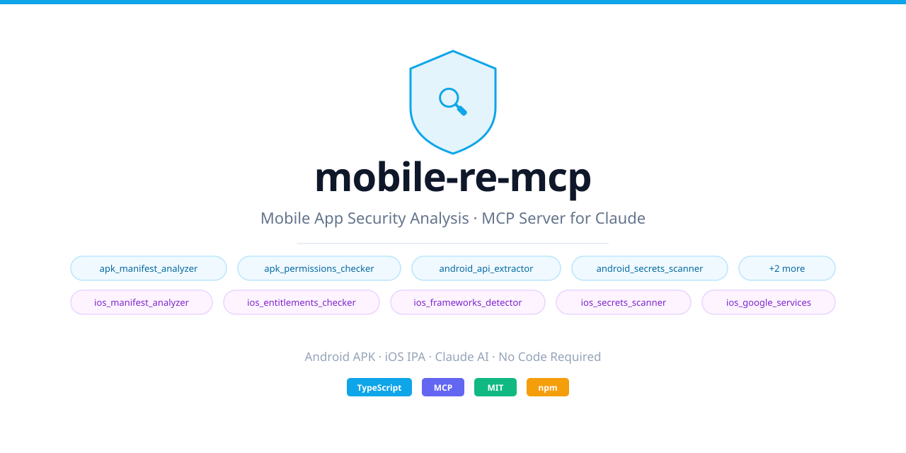

<picture>
  <source media="(prefers-color-scheme: dark)" srcset="docs/social-preview-dark.svg">
  
</picture>

[](https://www.npmjs.com/package/mobile-re-mcp) [](https://pypi.org/project/mobile-re-mcp/) [](https://github.com/FlyPhantomFly/mobile-re-mcp/actions) [](LICENSE)

mobile-re-mcp is two MCP servers in one repo, for two halves of the same job.

The **Python server**, published on PyPI as `mobile-re-mcp` (command `mobile-re-mcp-py`), is the live half and the larger of the two, with 56 tools. It drives adb, Frida, mitmproxy, apktool and jadx against a real Android device: decompile an app, hook it, read its traffic, patch it, sign it and install it again. It leads this README.

The **npm server**, published on npm as `mobile-re-mcp` (command `mobile-re-mcp`), is the file-reading half. It reads an Android APK or iOS IPA and reports what is inside — permissions, exported components, hardcoded secrets, Firebase config, entitlements, bundled SDKs — without ever running the app. It is described [further down](#the-npm-server).

You ask in plain language, the assistant calls the right tool, and the findings come back. Both packages share a version number, and you can install either one without the other.

---

## The Python server (the PyPI package)

### What exactly it does

`pip install "mobile-re-mcp[all]"` gives you an MCP server, started as `mobile-re-mcp-py`, that speaks MCP over stdio (or SSE on 127.0.0.1 with a bearer token) and exposes **56 tools over one Android target at a time**:

- **Static work on the APK file itself** — apktool and jadx decompilation, ripgrep searches across the decompiled folder, androguard manifest parsing and bytecode cross-references, apkid packer/obfuscator identification, apkleaks secret scanning, quark-engine behaviour rules (`quark_scan`), and an orchestrator (`apk_analyze_full`) that runs all of those in one call and scores the protection tier.
- **Dynamic work on a running app** — spawn or attach a process with Frida, inject JavaScript, stream script output back, hook SSL pinning, dump and search process memory, trace storage, crypto and network calls from a built-in script collection you can extend with your own scripts.
- **Work on the phone** — list devices, run shell commands, install APKs, pull and push files, capture logcat, mirror the screen with scrcpy, and take screenshots.
- **Network** — start and stop mitmproxy (loopback only), read captured flows as structured JSON, export them as HAR for Chrome DevTools or Burp.
- **Patching and signing** — edit smali in a decompiled folder, embed a Frida gadget so you can hook a non-rooted device, rebuild with apktool and sign with uber-apk-signer using your keystore or the debug one.
- **Native and cross-platform code** — strings/exports/disassembly for `.so` files, Il2CppDumper for Unity, Blutter and engine-version detection for Flutter, Hermes decoding for React Native.
- **Workflow support** — a RASP signature database and ready-made bypass scripts, per-target notes kept across sessions, a self-check of your toolchain, and 12 knowledge packs served as MCP resources and prompts (assessments, bypass escalation ladders, common mistakes).

It is Android only. Several tools change the device (install, push, patch), which is why the guard layer described below checks every call before it runs.

### Install

```bash
pip install "mobile-re-mcp[all]"
mobile-re-mcp-py --setup
```

It needs Python 3.11 or newer. The base install is just the MCP server. The extras pick up the heavy libraries, and you can install parts instead of all:

| Extra | What it adds | Which tools need it |
| --- | --- | --- |
| `[frida]` | frida, frida-tools | every `frida_*` tool, `ssl_kill_switch` |
| `[static]` | androguard, apkid, apkleaks | `manifest_parse`, `analyze_code`, `find_crypto_usage`, `find_urls`, `apk_identify`, `apk_scan_secrets`, `apk_analyze_full` |
| `[network]` | mitmproxy | `mitm_start/stop/read_flows/export_har` |
| `[analysis]` | quark-engine | `quark_scan` (also a best-effort stage of `apk_analyze_full`) |
| `[all]` | everything above | — |

If Frida is already pinned in your environment, install without extras and the server will not touch it.

`--setup` downloads pinned, checksum-verified copies of apktool 2.12.1, jadx 1.5.6, uber-apk-signer 1.3.0 and Il2CppDumper 6.7.46 into `~/tools`. adb comes from your package manager (`sudo apt install adb`); scrcpy and radare2 too. Run `mobile-re-mcp-py --setup` again any time to fill in whatever is missing.

The command is `mobile-re-mcp-py`, so it does not clash with the npm package's `mobile-re-mcp`.

### Connect it

Claude Code:

```bash
claude mcp add mobile-re-py -- mobile-re-mcp-py
```

opencode, in `~/.config/opencode/opencode.json`:

```json
{
  "mcp": {
    "mobile-re-py": { "type": "local", "command": ["/path/to/venv/bin/mobile-re-mcp-py"], "enabled": true }
  }
}
```

Claude Desktop, in `claude_desktop_config.json`:

```json
{
  "mcpServers": {
    "mobile-re-py": { "command": "/path/to/venv/bin/mobile-re-mcp-py" }
  }
}
```

Use the full path to the command if it lives in a virtualenv. Any other client needs only the command, with no arguments. stdio is the default transport; `--transport sse --port 8765` also works, listens on 127.0.0.1 only, and any other `--host` needs `MOBILE_RE_MCP_TOKEN`, which clients send as a bearer token.

Start with a check of what you have: ask "Run check_tools", and the assistant lists which tools it found (with versions) and which are missing, with install hints. On a set-up machine it should report `ok`; a fully-loaded box typically shows 30+ available.

### A first session

Ask in plain language, and the assistant picks the tools. Some prompts and what they use:

- "Check my devices and get frida-server onto the phone." (`adb_devices`, `frida_server_push`)
- "Decompile /home/me/apks/app.apk and search the strings for token or secret." (`apk_decompile`, `search_strings`)
- "What is this app, which framework, what protection does it use, and how bad is it overall?" (`apk_analyze_full`)
- "Which protection does com.example.app use, and how do I get past it?" (`rasp_identify`, `rasp_bypass`)
- "Track this app's network traffic." (`mitm_start`, then `adb reverse tcp:8080 tcp:8080`, open the app, `mitm_read_flows`, `mitm_export_har`)
- "Bypass SSL pinning in com.example.app and watch the requests." (`ssl_kill_switch` or a `frida_run_script` of `ssl_pinning_universal`)
- "Patch the license check in the smali, rebuild, sign and install it." (`smali_patch`, `apk_rebuild_sign`, `adb_install`)
- "Dump the app's memory and find the session key." (`frida_attach`, `frida_find_bytes`, `frida_memdump`)

The server also carries seven guided prompts (`master-workflow`, `first-look`, `rasp-assess`, `bypass-ssl`, `bypass-root`, `bypass-frida`, `stuck`) and keeps per-app notes so a later session can pick up where the last one stopped (`memory_read`, `memory_write`).

### The tool set

Every tool returns structured JSON with a `status` field (`ok`, `error`, `missing_tool`) — your assistant can chain calls. File arguments are absolute paths validated by the guard. `apk_decompile` and `apk_decompile_java` land next to the APK (`<name>_apktool/`, `<name>_jadx/`); dumps and captures go to the private data folder.

**Static analysis (8)**

| Tool | What it does | Needs |
| --- | --- | --- |
| `apk_decompile` | apktool decompile (smali + resources), or resources/smali only via `mode` | apktool |
| `apk_decompile_java` | jadx decompile to Java source | jadx |
| `apk_identify` | apkid: packers, obfuscators, compilers, anti-tamper | apkid |
| `apk_scan_secrets` | apkleaks: hardcoded keys and credentials, report saved as JSON | apkleaks |
| `apk_analyze_full` | runs apkid + apkleaks + manifest + quark in one call, adds framework guess and protection tier | apkid, apkleaks, androguard, (quark-engine) |
| `quark_scan` | quark-engine behaviour rules: scored matches like "send SMS" or "load dex from external source"; `keywords` filters, the rule set comes from `freshquark` or `rules_dir` | quark-engine |
| `manifest_parse` | androguard: package, versions, SDK levels, exported components, permissions, debuggable/allowBackup flags | androguard |
| `search_strings` | ripgrep with JSON output over any folder (a decompile, a dump, a HAR) | ripgrep |

**Bytecode deep-dive (3)**

| Tool | What it does | Needs |
| --- | --- | --- |
| `analyze_code` | cross-reference callers/callees for classes and methods | androguard |
| `find_crypto_usage` | list every javax.crypto / java.security call site and which API it uses | androguard |
| `find_urls` | all URLs and hostnames from bytecode constants and assets, sorted into api/auth endpoints | androguard |

**Frida sessions (6)**

| Tool | What it does | Needs |
| --- | --- | --- |
| `frida_spawn` | spawn an app with Frida and optionally inject a script | frida, rooted device or gadget |
| `frida_attach` | attach to an already-running process | same |
| `frida_inject` | inject another script into the live session | active session |
| `frida_read_output` | drain what the hooking session printed | active session |
| `frida_detach` | detach cleanly | active session |
| `objection_run` | run any objection command against a package | objection |

**Frida script library (3)**

| Tool | What it does | Needs |
| --- | --- | --- |
| `frida_list_scripts` | list available hook scripts by category (ssl_pinning, root_detection, crypto, memory, hooks, storage, network), including your own | nothing |
| `frida_get_script` | read the JS source of a named script (8 ship with the package; yours override) | nothing |
| `frida_run_script` | spawn + inject a named built-in script in one call, with optional config overrides | frida |

**Anti-detection (2)**

| Tool | What it does | Needs |
| --- | --- | --- |
| `frida_server_push` | push a frida-server (or the hluda/StrongR fork) matching your frida-tools version to the device | adb, frida-tools, binary in `~/tools` |
| `frida_spawn_hluda` | spawn through the renamed hluda server so Frida port/name scans come up empty | hluda server running on the device |

**Process memory (2)**

| Tool | What it does | Needs |
| --- | --- | --- |
| `frida_memdump` | dump every rw- memory region of the target to disk files | active session |
| `frida_find_bytes` | search process memory for a UTF-8 string or hex pattern, with addresses | active session |

**Device control (11)**

| Tool | What it does | Needs |
| --- | --- | --- |
| `adb_devices` | list devices with serial and state | adb |
| `adb_shell` | run a shell command on the device (split on the host, safely) | adb |
| `adb_install` | install an APK (`install -r -t`) | adb |
| `adb_pull` / `adb_push` | copy files between host and device | adb |
| `adb_logcat_start` / `read` / `stop` | stream and buffer up to 50k log lines in the background | adb |
| `hermes_decode` | extract and decode the React Native Hermes bundle to readable JS | hermes-dec or hbctool |
| `scrcpy_start` | mirror the device screen, optionally recording to MP4 | scrcpy |
| `scrcpy_screenshot` | capture a PNG of the current screen | adb only |

**Network (5)**

| Tool | What it does | Needs |
| --- | --- | --- |
| `mitm_start` | start mitmdump bound to 127.0.0.1, write a `.mitm` capture | mitmproxy |
| `mitm_stop` | stop it, report the capture path | — |
| `mitm_read_flows` | parse the capture into JSON: method, URL, bodies, status | mitmproxy |
| `mitm_export_har` | export the capture as HAR for DevTools/Burp | mitmproxy |
| `ssl_kill_switch` | inject the ssl-kill-switch2 script (OkHttp, TrustKit, native SSL) into a running app | frida |

**Patching and signing (4)**

| Tool | What it does | Needs |
| --- | --- | --- |
| `smali_patch` | replace text or regex in one smali class, optionally scoped to one method; keeps a `.bak` | a decompiled folder |
| `inject_gadget` | full 6-step Frida-gadget embed: decompile, copy .so, write config, patch loadLibrary, rebuild, sign | apktool, java, gadget .so in `~/tools/gadgets` |
| `apk_sign` | sign with uber-apk-signer (debug keystore or your `[signing]` config) | java, signer jar |
| `apk_rebuild_sign` | apktool build + sign in one step | apktool, java, signer jar |

**Native libraries (4)**

| Tool | What it does | Needs |
| --- | --- | --- |
| `native_strings` | strings from a `.so` or all libs in an APK, filtered to interesting ones | strings (or pure-Python fallback) |
| `native_exports` | exported symbols per library | readelf/nm (or built-in ELF parser) |
| `native_disasm` | radare2 disassembly of a function (asm, graph or pseudocode) | radare2 |
| `il2cpp_dump` | Unity: dump.cs + script.json from libil2cpp.so + global-metadata.dat | Il2CppDumper |

**Flutter / Dart (3)**

| Tool | What it does | Needs |
| --- | --- | --- |
| `flutter_version` | engine commit hash + SDK/Dart version fingerprints from libflutter.so | nothing |
| `dart_snapshot_info` | AOT/JIT snapshot kind; warns when the ELF header was wiped (zShield) | nothing |
| `blutter_extract` | Blutter run on libapp.so: class/method symbols, asm, pseudo-code for IDA/Ghidra | blutter clone |

**RASP assessment (2)**

| Tool | What it does | Needs |
| --- | --- | --- |
| `rasp_identify` | vendor fingerprinting (Guardsquare, Arxan, Promon, Zimperium, custom) from APK entry names and apkid | optional apkid |
| `rasp_bypass` | returns a ready Frida script for vendor + protection (root, SSL, Frida detection, integrity, emulator) | nothing |

**Per-target notes (2)** and **Setup (2)**

| Tool | What it does | Needs |
| --- | --- | --- |
| `memory_read` / `memory_write` | session notes per package, pre-seeded with a findings template so follow-up sessions can resume | nothing |
| `check_tools` | full inventory of your toolchain with versions, paths, install hints and the MCP tools that use each entry (`used_by`); pip CLIs are probed as executables, and the `medusa` entry refuses the SSH-cracker namesake | nothing |
| `install_tool` | install a missing tool from a pinned SHA-256-checked download, pip or npm; `medusa`/`fridump` deliberately have no auto-recipe (name-collision / unused) | off unless `MOBILE_RE_MCP_ALLOW_INSTALL=1` |

### Knowledge packs and prompts

Five MCP **resources**: `knowledge://detection-patterns` (root/Frida/emulator/integrity checks and their counters), `knowledge://bypass-playbooks` (escalation ladders), `knowledge://framework-fingerprints` (React Native, Flutter, Unity, Xamarin from artefacts), `knowledge://crypto-patterns` (hardcoded keys, weak IVs, insecure ciphers) and `knowledge://common-mistakes`. Seven MCP **prompts** wrap the same packs: `master-workflow`, `first-look`, `rasp-assess`, `bypass-ssl`, `bypass-root`, `bypass-frida`, `stuck`. Your client's prompt picker lists them; they cost nothing to call.

Eight bypass/monitor scripts ship with the package (`ssl_pinning_universal`, `root_detection_bypass`, `frida_detection_bypass`, `crypto_monitor`, `memory_scan`, `method_tracer`, `storage_monitor`, `network_monitor`) — every one accepts live config: post or send `{type:'config', ...}` (UPPER-case keys as shown by `frida_list_scripts` usage strings; lowercase accepted too). Drop your own script into `~/.local/share/mobile-re-mcp/frida_scripts` using the same catalogue filename and yours is used instead of the shipped one.

### Files and settings

- Notes, captures and scratch files: `~/.local/share/mobile-re-mcp` (`MOBILE_RE_MCP_HOME` to move; created `0700`)
- Your settings: `~/.config/mobile-re-mcp/config.toml` (`MOBILE_RE_MCP_CONFIG`) — today just `[signing]` keystore paths and passwords
- Downloaded tools: `~/tools` (`MOBILE_RE_MCP_TOOLS_DIR`); subfolders (jadx, platform-tools, il2cppdumper, scrcpy) are appended to the server's PATH if present
- `MOBILE_RE_MCP_ALLOWED_DIRS` — folders (separated by `:`) that all file arguments must stay inside
- `MOBILE_RE_MCP_DISABLE_TOOLS` — comma-separated tools to switch off, e.g. `adb_shell,adb_push,adb_pull`
- `MOBILE_RE_MCP_ALLOW_INSTALL=1` — the only way `install_tool` becomes callable over MCP (`--setup` always works)

### Staying safe

This server runs commands on your phone and your computer, so treat its tools with care.

- Every call passes the guard first: file arguments reject a leading `-`, NUL bytes, and protected locations (`~/.ssh`, `~/.config/gh`, shell rc files, keyrings, …); `package`, `serial`, `port` and similar arguments are pattern-checked; writes into `/etc` are refused.
- The stateful tools (`frida_spawn`, `adb_shell`, `adb_install`, `mitm_*`, signing) change a real device — set them to ask first in your client, and keep `MOBILE_RE_MCP_DISABLE_TOOLS` around anything you do not want reachable.
- mitmproxy listens on 127.0.0.1. Run `adb reverse tcp:8080 tcp:8080` and point the phone's proxy at 127.0.0.1:8080.
- SSE transport is loopback-only unless you set `MOBILE_RE_MCP_TOKEN`; foreign Host headers are rejected.
- Downloads are pinned to a release and SHA-256-verified. Scratch files live in a private `0700` folder, never `/tmp`.
- A sample you analyze can try to steer the assistant through its own strings and symbol names. Use a VM for hostile samples, and do not auto-approve tools that touch the device.

---

## The npm server

The npm package is deliberately the opposite temperament: it never runs the app, never touches a device, and works on both platforms. It reads an APK or IPA and tells your assistant what is inside — a natural first step before the Python server, and the only half with iOS support (best on a Mac, where `plutil` and `codesign` live).

### An example

The sample below is an APK made for this README: a small notes app with a few deliberate mistakes in it. You ask:

> Check /home/me/apks/NotesDemo.apk for anything risky.

The assistant runs the manifest analyzer, the permissions checker and the secrets scanner. The output is trimmed here, and key values are masked:

```text
=== Android Manifest Analysis ===
Package Name : com.example.notes
Version Name : 2.3.1
--- Security Flags ---
  debuggable          : TRUE  ⚠ DANGER
  allowBackup         : TRUE  ⚠ WARNING
  usesCleartextTraffic: TRUE  ⚠ DANGER
--- Exported Components (android:exported="true") ---
  ⚠ 5 exported component(s):
    - com.example.notes.MainActivity (activity)
    - com.example.notes.ShareActivity (activity)
    - com.example.notes.SyncService (service)
    - com.example.notes.BootReceiver (receiver)
    - com.example.notes.NotesProvider (provider)
```
```text
=== APK Permissions Analysis ===
--- Dangerous Permissions (4) ---
  ⚠ android.permission.CAMERA
  ⚠ android.permission.ACCESS_FINE_LOCATION
  ⚠ android.permission.READ_CONTACTS
  ⚠ android.permission.WRITE_EXTERNAL_STORAGE
```
```text
=== Android Secrets Scanner ===
[CRITICAL] AWS Access Key ID
  → AKIA…DEMO
⚠ 1 CRITICAL finding(s) — immediate review required.
```
From there you can keep talking: "Which of those exported components can I drop?" The assistant already has the findings and can answer. iOS works the same way with an IPA and the `ios_*` tools.


### Install

```bash
npm install -g mobile-re-mcp
```

You need Node 22 or newer. The server speaks MCP over stdio, so register it with your client as a command.

Claude Code:

```bash
claude mcp add mobile-re -- npx -y mobile-re-mcp
```

opencode, in `~/.config/opencode/opencode.json`:

```json
{
  "mcp": {
    "mobile-re": { "type": "local", "command": ["npx", "-y", "mobile-re-mcp"], "enabled": true }
  }
}
```

Claude Desktop, in `claude_desktop_config.json` (macOS: `~/Library/Application Support/Claude/`, Windows: `%APPDATA%\Claude\`):

```json
{
  "mcpServers": {
    "mobile-re": { "command": "npx", "args": ["-y", "mobile-re-mcp"] }
  }
}
```

Other clients work the same way: command `npx`, arguments `-y mobile-re-mcp`. If your client cannot see your shell's PATH (common with nvm), give it the full path to `node` and to `dist/index.js` in the global install.
To run from a checkout, use `git clone https://github.com/FlyPhantomFly/mobile-re-mcp.git`, then `npm ci && npm run build`, and point the client at `node /path/to/mobile-re-mcp/dist/index.js`.

### What to ask

- "Which permissions in /path/to/app.apk are dangerous, and why?"
- "Are any components in this APK exported where an attacker could reach them?"
- "What API endpoints does this APK call?"
- "Which Firebase project does this app use, and are its keys in the app?"
- "Scan this IPA for hardcoded keys and tell me where each one was found."
- "Which third-party SDKs does this iOS app bundle, and which of them track users?"

### Tools

Every tool takes the file as an absolute path, `apk_path` for Android or `ipa_path` for iOS.

| Tool | What it reports | Needs |
| --- | --- | --- |
| `apk_manifest_analyzer` | Package info, `debuggable` and `allowBackup` flags, exported components, intent filters | `aapt`, or `apktool` |
| `apk_permissions_checker` | Permissions split into dangerous and normal, with a short reason for each | `aapt` or `aapt2`, or `apktool` |
| `android_api_extractor` | Retrofit endpoints and OkHttp fields from decompiled smali, as text or a Postman collection | `apktool`, or a smali folder you already have |
| `android_google_services` | Firebase and Google Cloud settings from `google-services.json` and `resources.arsc` | `strings` |
| `android_secrets_scanner` | Hardcoded keys and credentials in DEX files, resources and assets | `strings` |
| `android_native_libraries` | Every `lib/<abi>/*.so` with known packer/RASP/framework/SDK matches and ELF section inspection | nothing |
| `ios_manifest_analyzer` | Bundle info, ATS settings, URL schemes, background modes, warnings | `plutil` for binary plists |
| `ios_permissions_checker` | Privacy permission strings ranked HIGH, MEDIUM or LOW | `plutil` for binary plists |
| `ios_entitlements_checker` | Entitlements, with flags like `get-task-allow` and sandbox exceptions | `codesign` (macOS) |
| `ios_binary_strings` | URLs, emails, IPs and key-like strings from the Mach-O binary | `strings` |
| `ios_frameworks_detector` | Bundled frameworks and dylibs, matched against about 60 known SDKs | nothing |
| `ios_google_services` | The contents of `GoogleService-Info.plist` | `plutil` for binary plists |
| `ios_secrets_scanner` | Secrets in resource files and in the binary, with severity | `strings` |

Some tools take extra options. `smali_folder` lets the Android tools reuse an existing decompile. `android_api_extractor` also takes `output_format` (`txt` or `postman`). The scanners take `min_length`, and `ios_binary_strings` takes `filter` (`all`, `url`, `key`, `email` or `ip`).

`aapt`, `apktool`, `strings` and `plutil` need to be on your PATH. `plutil` and `codesign` only exist on macOS. Most real IPAs use binary plists, so on Linux the plist-based iOS tools only work on IPAs with XML plists, and the full iOS set is best run on a Mac. On Windows the tools start without a shell, so `apktool` has to resolve to a real `.exe`, not `apktool.bat`.

### Staying safe

- External programs are started with an argument array, never through a shell, so a crafted path cannot inject a command.
- The file has to exist, be an absolute path and look like a ZIP (`.apk` or `.ipa`).
- To limit where the server may read, set `MOBILE_RE_MCP_ALLOWED_DIRS` (separate folders with `:`, or `;` on Windows). For example, in the Claude Desktop entry add `"env": { "MOBILE_RE_MCP_ALLOWED_DIRS": "/home/me/apks" }`.
- Zip-bomb guard: inputs are capped at 2048 MB and any single decompressed entry at 256 MB (`MOBILE_RE_MCP_MAX_FILE_MB` / `MOBILE_RE_MCP_MAX_ENTRY_MB`, `0` disables a cap). A crafted 2 KB APK that expands to 2 GB can no longer OOM the server — oversized entries are reported as `[skipped: …]` where the tool can continue, and oversized inputs fail with a clear message.
- An untrusted app is hostile input for `apktool`, `aapt` and `strings`. Keep them updated, and for samples you do not trust, run the server in a VM or container.
- Findings, including any secrets that were found, go to your AI client and so to its model provider.

---

## Working on it

Build the npm server with `npm ci && npm run build`; the Python server lives in [`python/`](python) with its own README, config and tests. [CONTRIBUTING.md](CONTRIBUTING.md) explains how to add a tool or a detection pattern, [SECURITY.md](SECURITY.md) is for reporting vulnerabilities, and [CHANGELOG.md](CHANGELOG.md) lists what changed. [docs/code-review-and-extensions.md](docs/code-review-and-extensions.md) documents the current function of both servers, findings from a full review, and the proposed extensions.

## License

MIT. © 2026 FlyPhantomFly.
